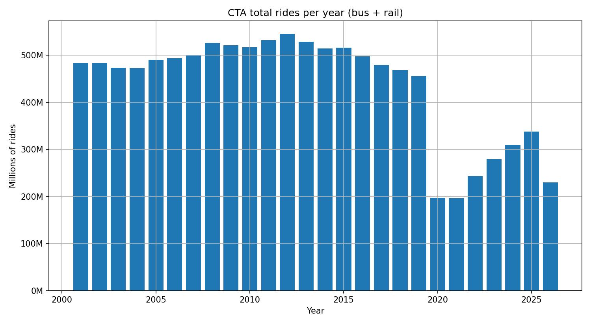
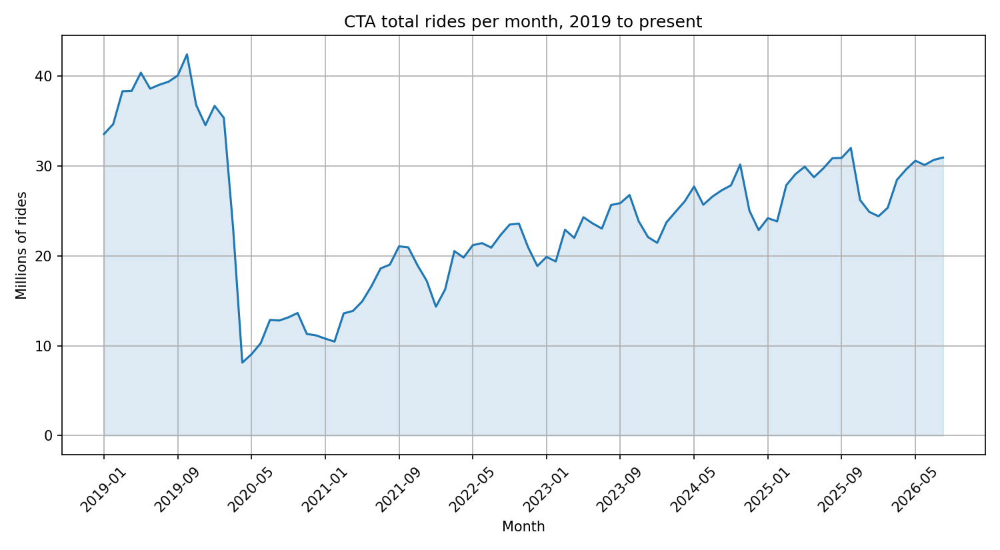
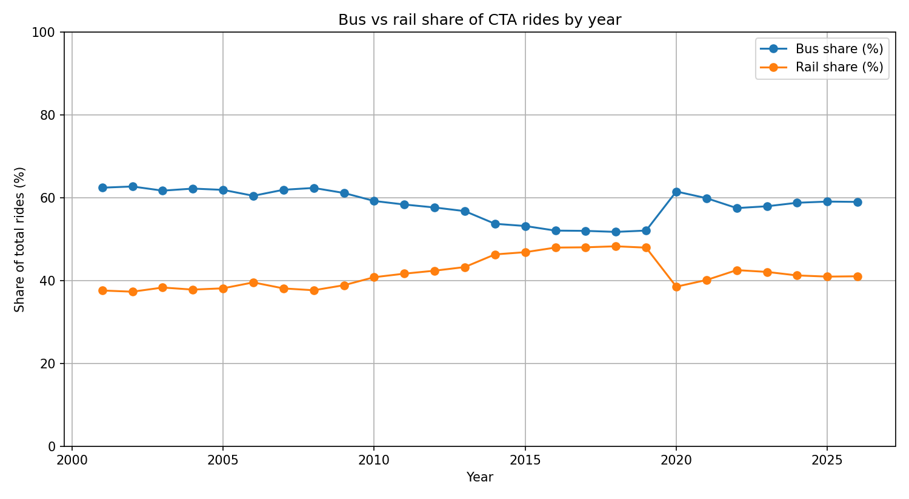

# CTA Ridership: How Far Back Is Chicago Transit, Really?

## The question

How has CTA ridership recovered since COVID, and which days and modes are driving it?

Short answer: it hasn't fully come back. Ridership in 2025 was 338 million rides — about 74% of 2019 — and the recovery is uneven. Weekends are back to roughly 80% of 2019 levels while weekdays sit near 65%, and rail is lagging bus. The numbers below come from the CTA's own daily boarding totals, 2001 to the present.

## Findings

All figures computed from the dataset in this repo (see [How to run it](#how-to-run-it)).

**The drop and the climb back**

| Year | Total rides | vs 2019 |
|------|-------------|---------|
| 2019 | 455.7M | — |
| 2020 | 197.5M | −56.6% |
| 2021 | 196.0M | −57.0% |
| 2022 | 243.5M | −46.6% |
| 2023 | 279.1M | −38.7% |
| 2024 | 309.2M | −32.2% |
| 2025 | 338.0M | −25.8% |

- The worst month was **April 2020: 8.1M rides**, about 19% of the best 2019 month (October 2019, 42.4M).
- Monthly ridership did not pass 30M again until **October 2024** — four and a half years after the drop.
- The latest 12 months in the data (Sep 2025–Aug 2026) total **343.9M rides, 75.5% of 2019**.
- Growth is still happening but slow: Jan–Aug 2026 (230.0M) is up 2.6% on the same months in 2025.

**Weekdays lag, weekends lead**

| Daily average | Weekday | Saturday | Sunday / holiday |
|---------------|---------|----------|------------------|
| 2019 | 1,468,731 | 855,270 | 633,502 |
| 2024 | 953,787 | 683,654 | 508,233 |
| 2024 as % of 2019 | 64.9% | 79.9% | 80.2% |

Weekday commuting is the weak spot — consistent with remote and hybrid work cutting the daily commute — while weekend travel has recovered noticeably faster.

**Bus recovered faster than rail**

| Year | Bus share | Rail share |
|------|-----------|------------|
| 2019 | 52.1% | 47.9% |
| 2020 | 61.5% | 38.5% |
| 2023 | 57.9% | 42.1% |
| 2024 | 58.8% | 41.2% |
| 2025 | 59.1% | 40.9% |

Rail fell further in 2020 and has closed the gap more slowly. Bus now carries about 59% of rides, up from 52% before COVID.

**The longer view matters too**

Ridership was already falling before COVID. The all-time peak in this data is **2012 at 545.6M rides**; 2019 was already about 16% below that. So the COVID drop hit a system in long-term decline, and "back to 2019" would still be well below the peak.







## The data

- **Source:** Chicago Data Portal, [CTA – Ridership – Daily Boarding Totals](https://data.cityofchicago.org/resource/6iiy-9s97.json) (Socrata API, no key needed).
- **Coverage:** daily systemwide boardings, 2001-01-01 to 2026-08-31 (9,374 days).
- **Columns:** `service_date`, `day_type` (W = Weekday, A = Saturday, U = Sunday/Holiday), `bus`, `rail_boardings`, `total_rides`.
- **What it counts:** boardings, not linked trips — a rider who transfers bus-to-rail counts twice. That is how CTA reports it, so year-to-year comparisons are consistent.

**Caveats**

- The data lags: as of early November 2026, the latest date published is 2026-08-31, so 2026 figures are January–August only.
- `day_type = U` mixes Sundays and holidays, so Sunday averages include holiday dips.
- 2020 is a leap year (366 days), which slightly flatters its yearly total.

## How to run it

```bash
python3 fetch_ridership.py   # pulls the data into data/ridership.sqlite
python3 analysis.py          # prints the headline stats, saves charts to charts/
```

`fetch_ridership.py` is incremental: the first run loads the full history, later runs only fetch dates newer than what is already in the database. The SQLite file is not committed to the repo — the fetch script rebuilds it. A one-year sample (`data/sample_2024.csv`) is included so the repo is explorable without running the fetch.

## Pipeline

```
Chicago Data Portal API  →  fetch_ridership.py  →  SQLite (data/ridership.sqlite)
                                                        ↓
                                                  analysis.py
                                                        ↓
                                   printed stats + PNG charts (charts/)
```

Python 3, standard library plus `requests` and `matplotlib` (see `requirements.txt`).

## What's next

- Break the recovery down by month-of-year to separate seasonal effects from the trend.
- Pull CTA service data (scheduled vs actual service) to test whether service cuts explain part of the rail lag.
- Add a simple forecast for when ridership would reach 2019 levels at the current growth rate.
